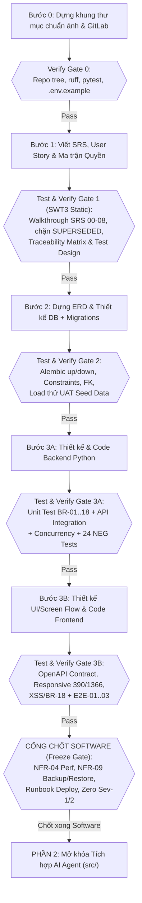
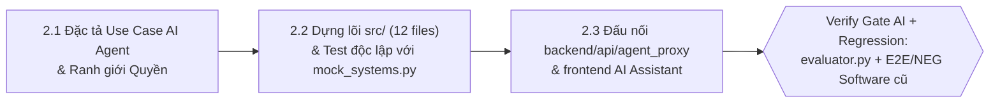

# Quy trình Thiết kế Phần mềm (Software-First + Test/Verify Xen kẽ → Tích hợp AI Agent)

> [!IMPORTANT]
> **Chiến lược 2 Giai đoạn Lớn (Two-Phase Delivery)** theo yêu cầu của bạn:
> - **PHẦN 1 — SOFTWARE CORE (Ưu tiên 100% & Chốt dứt điểm)**: Tập trung toàn lực hoàn thiện phần mềm (`SRS/User Story → ERD & DB → Backend Python → Frontend`) với **các cổng Test & Verify xen kẽ ngay sau mỗi bước**, đối chiếu chặt chẽ với bộ `SRS/00`–`08` và `Support Documents` (`SWP391`, `SWR302`, `SWT301`).
> - **CỔNG CHỐT SOFTWARE (Software Freeze Gate)**: Chỉ khi phần Software chạy ổn định, vượt qua `E2E-01`–`03`, `NEG-01`–`24`, `NFR-01`–`12` và được bạn nghiệm thu/chốt mới bước sang Phần 2.
> - **PHẦN 2 — TÍCH HỢP AI AGENT (`src/`)**: Dựng 12 module AI Agent đúng chuẩn kiến trúc trong ảnh mẫu, đấu nối vào `backend/` & `frontend/` đã ổn định, kèm kiểm thử RAG/Guardrails và regression test bảo vệ phần Software.

---

## 1. Cấu trúc Dự án Chuẩn (Theo Ảnh Mẫu `PRJ_Agents_Group1_new_2`)


Ngay từ **Bước 0**, toàn bộ cấu trúc thư mục được dựng theo đúng ảnh mẫu để phần **Software** vận hành độc lập hoàn chỉnh trước, đồng thời để sẵn vị trí sạch sẽ cho **AI Agent (`src/`)** ở Phần 2:

```text
FinalProject/
├── artifacts/                        # [Dùng từ Phần 1] Log test, báo cáo UAT, kết quả benchmark NFR-04; [Phần 2] thêm AI eval reports
├── backend/                          # [PHẦN 1 - TRỌNG TÂM] Software Backend bằng Python (FastAPI + SQLAlchemy + Alembic)
│   ├── app/
│   │   ├── api/                      # Routers: public, sales, transport, rental, warehouse, payment, admin (+ agent_proxy ở Phần 2)
│   │   ├── core/                     # Auth/Session, Password Hash, 128-bit Token, RBAC, Rate Limit, Audit, Correlation ID
│   │   ├── db/                       # Database engine, session, Alembic migrations/
│   │   ├── models/                   # SQLAlchemy ORM models (11 nhóm thực thể SRS + Audit)
│   │   ├── schemas/                  # Pydantic DTOs (validation chặt, tiền tệ VND số nguyên, Asia/Ho_Chi_Minh)
│   │   ├── repositories/             # Data access, locking (SELECT ... FOR UPDATE), optimistic version
│   │   └── services/                 # Business Logic thực thi BR-01..BR-18 & State Machine
│   └── main.py
├── data/                             # [PHẦN 1] UAT seed data, bộ tài liệu nghiệp vụ (POL/SOP/TPL/FAQ), vùng upload an toàn
│   ├── policies/                     # Tài liệu nghiệp vụ phân tách bản ACTIVE vs SUPERSEDED
│   ├── seed/                         # Bộ dữ liệu UAT tối thiểu (SRS 08 Mục 2)
│   └── uploads/                      # Lưu tệp đính kèm PDF/JPG/PNG <= 5MB (NFR-07)
├── docs/                             # [PHẦN 1] Bộ tài liệu chuẩn SWP391 (chuyển ngữ Python)
│   ├── SRS_RDS_Document.md           # Theo Template2_RDS Document.docx
│   ├── SDS_Document.md               # Theo Template3_SDS Document.docx
│   ├── ERD_Database_Design.md        # ERD, từ điển dữ liệu, constraints & migration plan
│   ├── Test_Plan_and_Traceability.md # Ma trận truy vết Story ↔ BR ↔ NFR ↔ E2E/NEG (SRS 08 + SWT301)
│   ├── Project_Tracking.xlsx         # Theo Template1_Project Tracking.xlsx
│   ├── Issues_Report.xlsx            # Theo Template4_Issues Report.xlsx
│   ├── AI_Usage_Report.xlsx          # Theo Template0_AI_Usage_Report
│   └── Final_Release_Document.docx   # Theo Template5_Final Release Document.docx
├── frontend/                         # [PHẦN 1 - TRỌNG TÂM] Public Website (390px+) & Internal Portal (1366x768)
│   ├── src/
│   │   ├── portals/public/           # Trang chủ, 3 dịch vụ, gửi yêu cầu, xác nhận, tra cứu tiến độ
│   │   ├── portals/internal/         # Cổng nội bộ theo 6 vai trò: SAL, DSP, WHS, FIN, MGR, ADM
│   │   ├── services/api/             # API client bám OpenAPI schema của backend/
│   │   └── components/               # UI components dùng chung (+ AI Assistant drawer bổ sung ở Phần 2)
├── src/                              # [PHẦN 2 - MỞ KHÓA SAU KHI CHỐT SOFTWARE] Lõi AI Agent (12 files chuẩn ảnh mẫu)
│   ├── __init__.py
│   ├── agent_orchestrator.py         # Điều phối luồng Agent, intent routing & tool calls
│   ├── config.py                     # Cấu hình model, RAG top-k, timezone, đường dẫn policies
│   ├── evaluator.py                  # Chấm điểm grounding, chặn SUPERSEDED, kiểm tra rò rỉ BR-18
│   ├── generate_policy_pdfs.py       # Chuẩn hóa & sinh PDF Policy/SOP từ data/policies/
│   ├── llm_client.py                 # Wrapper gọi LLM + logging có correlation_id
│   ├── memory_manager.py             # Quản lý hội thoại tách biệt theo session & role
│   ├── mock_systems.py               # Mock dữ liệu/tools để test Agent độc lập
│   ├── models.py                     # Models dùng cho Agent (AgentQuery, PolicyDocument, Citation, AgentResponse)
│   ├── rag_engine.py                 # PolicyRAGEngine (Category, Bilingual synonyms, Untrusted filter, Version conflict)
│   ├── tool_registry.py              # Đăng ký & kiểm quyền tools nối vào backend/services
│   └── validators.py                 # Input/Output guardrails (chống injection/XSS, RBAC & BR check)
├── tests/                            # [PHẦN 1 + 2] Kiểm thử đa tầng xen kẽ từng giai đoạn
│   ├── unit/                         # Gate 3A: Unit test services, state machines, validators
│   ├── integration/                  # Gate 3A: API, RBAC, Concurrency, NEG-01..NEG-24
│   ├── e2e/                          # Gate 3B/4: E2E-01, E2E-02, E2E-03 & kịch bản demo web
│   └── agent_eval/                   # [Phần 2] Kiểm thử AI Agent & regression test
├── .env                              # Secret cấu hình local (không commit)
├── .env.example                      # Mẫu biến môi trường (NFR-11)
├── demo.md                           # Hướng dẫn demo nhanh
├── HUONG_DAN_25_KICH_BAN_DEMO_WEB.md # Kịch bản demo 3 E2E + 24 NEG (SRS 08)
├── README.md                         # Hướng dẫn cài đặt, chạy & test (NFR-11)
└── requirements.txt                  # Dependencies Python (Phần 1: FastAPI/SQLAlchemy/Pytest; Phần 2: bổ sung LLM/RAG)
```

---

## 2. Chuyển đổi Kỹ thuật từ Support Docs (Java → Python)

| Tài liệu / Chuẩn Java trong `Support Documents` | Chuẩn áp dụng cho Backend Python | Tham chiếu |
|---|---|---|
| **JDK + Servlet/Spring + NetBeans** | **Python 3.11+**, **FastAPI**, **Pydantic v2**, **SQLAlchemy 2.0**, **Alembic**, **Uvicorn** | `Student Guides Document.pdf` |
| **Oracle Java Coding Standards** | **PEP 8**, **Type Hints 100%**, linter/formatter **`ruff`**, docstring chuẩn Google/NumPy | `Oracle Java Coding Standards.pdf` |
| **Java Packages** (`controller/dao/entity`) | `api/` (routers) → `schemas/` (DTO) → `services/` (logic) → `repositories/` (DB) → `models/` (ORM) | `Template2_RDS`, `Template3_SDS` |
| **MySQL JDBC & SQL Queries** | **PostgreSQL** (staging/prod) + **SQLAlchemy + Alembic** (kèm SQL truy vấn & index/lock plan trong `SDS_Document`) | `Template3_SDS` (I.2, II.1.d) |
| **JUnit / Manual Test** | **`pytest` + `httpx` (AsyncClient)** cho Unit/API/Concurrency + **Playwright** (hoặc pytest API+UI) cho E2E | `1_SWT301`, `08_Acceptance` |

---

## 3. PHẦN 1: Quy trình Software-First với Test & Verify Xen kẽ

Mỗi bước làm đều đi theo mô hình **Build → Test & Verify Gate** (lồng ghép kỹ thuật Static Testing `SWT3`, Black-box/State Transition/Boundary Value `SWT4`, và tiêu chí nghiệm thu `SRS/08`). **Không qua bước sau nếu Gate của bước hiện tại chưa đạt.**



---

### Bước 0: Khởi tạo Khung Dự án & GitLab Workflow
- **Việc cần làm**:
  1. Dựng cây thư mục chuẩn mục 1 (tạo sẵn `backend/`, `frontend/`, `data/`, `docs/`, `tests/`, `artifacts/`, để `src/` ở trạng thái placeholder sạch sẽ cho Phần 2).
  2. Cấu hình GitLab theo [Git & GitLab Guides_Doc.pdf](file:///D:/Ber/OJT-CPL/FinalProject/Support%20Documents/1_SWP391/Git%20&%20GitLab%20Guides_Doc.pdf): nhánh `main` (protected), milestones `Iter1`..`Iter4`, labels (`WP`, `Task`, `Q&A`, `Defect`, `Leakage`, `1_To Do`, `2_Doing`, `3_Done`).
  3. Khởi tạo `docs/Project_Tracking.xlsx` ([Template1](file:///D:/Ber/OJT-CPL/FinalProject/Support%20Documents/2_SWP391/Template1_Project%20Tracking.xlsx)), `docs/Issues_Report.xlsx` ([Template4](file:///D:/Ber/OJT-CPL/FinalProject/Support%20Documents/2_SWP391/Template4_Issues%20Report.xlsx)), `docs/AI_Usage_Report.xlsx` ([Template0](file:///D:/Ber/OJT-CPL/FinalProject/Support%20Documents/2_SWP391/Template0__SWP391_AI_Usage_Report_%20Template.xlsx)).
- **Verify Gate 0**:
  - [ ] Cấu trúc thư mục khớp ảnh mẫu; không commit `.env` chứa secret (`NFR-02/11`).
  - [ ] Lệnh `ruff check .` và `pytest` chạy được trên môi trường local của mọi thành viên.

---

### Bước 1: Viết SRS, User Story & Ma trận Phân quyền (Software Scope)
Áp dụng `1_SWR302`, `2_SWR302`, [Template2_RDS Document.docx](file:///D:/Ber/OJT-CPL/FinalProject/Support%20Documents/2_SWP391/Template2_RDS%20Document.docx) và toàn bộ `SRS/00`–`08`.
- **Việc cần làm**:
  1. **Phần Overview (`Template2_RDS` Mục I)**:
     - Mô tả 7 Actors (`GST`, `SAL`, `DSP`, `WHS`, `FIN`, `MGR`, `ADM`), vẽ Use Case Diagram tổng & theo 7 phân hệ (`PUB`, `SAL`, `TRN`, `RNT`, `WHS`, `PAY`, `ADM`).
     - Lập **Screens Flow**, **Screen Descriptions**, **Screen Authorization Matrix** (chi tiết tới từng thao tác Đọc/Tạo/Sửa/Chuyển trạng thái của 7 role) và **Non-UI Functions** (tính quá hạn, hết hạn báo giá, cleanup session, backup).
  2. **Phần Requirement Specifications (`Template2_RDS` Mục II)**:
     - Viết đặc tả chi tiết cho **34 User Stories** (`PUB-01..05`, `SAL-01..09`, `TRN-01..05`, `RNT-01..05`, `WHS-01..06`, `PAY-01..04`, `ADM-01..06`): Preconditions, Postconditions, Normal Flow, Alternative Flows, Exceptions (`X.Y.EZ`), Acceptance Criteria (Given-When-Then), và liên kết mã `BR-01..18`, `NFR-01..12`.
  3. **Phần Appendix**: Chốt bảng 18 Business Rules (`BR-01`–`BR-18`) và bảng chuyển trạng thái hợp lệ (Mục 4 `00_Overall_SRS.pdf`).
- **Test & Verify Gate 1 (Static Testing theo `SWT3` & `SWR302` Ch.17–19)**:
  - [ ] **Checklist Review SRS**: Đủ 33 story `Must` + 1 story `Should` (`ADM-06`); không sót ràng buộc nào của `BR-01`–`BR-18`.
  - [ ] **Kiểm soát phiên bản tài liệu (`SRS/08` Mục 8.2)**: Rà soát toàn bộ SRS & backlog, bảo đảm **0 tham chiếu** lấy bản `SUPERSEDED` (`POL-COM-003 v1.0`, `POL-TRN-001 v1.0/v1.1`, `SOP-WHS-001 v1.0`, `SOP-ADM-001 v1.0`) làm quy tắc vận hành; chỉ dùng bản `ACTIVE`.
  - [ ] **Thiết kế Test Case sớm (`SWT4` + `SRS/08`)**: Lập `docs/Test_Plan_and_Traceability.md` ánh xạ mỗi Story ↔ Test Cases bằng kỹ thuật:
    - *State Transition Testing*: ServiceRequest, Quote, ServiceOrder, TransportTrip, RentalRecord, WarehouseLot/Doc, Payment.
    - *Boundary Value & Equivalence Partitioning*: Tiền VND nguyên dương/0, khối lượng `> 0`, `odo_return >= odo_handover`, khoảng lịch `[start, end)` chạm biên `08:00–10:00` và `10:00–12:00`, file `<= 5MB` (`PDF/JPG/PNG`), rate limit `5 req/10m` và `10 fail/15m`.
    - *Decision Table*: Ma trận phân quyền 7 vai trò và tổ hợp kiêm vai trò.

---

### Bước 2: Dựng ERD & Thiết kế Database (PostgreSQL + SQLAlchemy + Alembic)
Áp dụng `1_SWR302` Ch.12 (Data Modeling), Mục 5 `00_Overall_SRS.pdf`, và `Template3_SDS` (Mục I.2).
- **Việc cần làm**:
  1. Thiết kế ERD đầy đủ **11 nhóm thực thể lõi** trong `docs/ERD_Database_Design.md`:
     - *Auth & Master*: `users`, `roles`, `user_roles`, `user_sessions`, `master_categories`, `public_contents`.
     - *Sales & Public*: `customers`, `service_requests` (có `raw_payload`, `lookup_token_hash`), `request_interactions`, `quotes`, `quote_lines`, `service_orders` (`request_id` UNIQUE, `snapshot_json`, `version`).
     - *Operations*: `vehicles` (`plate_normalized` UNIQUE), `drivers`, **`resource_bookings`** (dùng chung Vận tải + Thuê xe), `transport_trips`, `trip_incidents`, `rental_records`, `warehouse_lots`, `lot_lines`, `warehouse_documents` (`source_doc_id`, `linked_transport_order_id`), `warehouse_document_lines`, `evidence_files`.
     - *Finance & Audit*: `surcharges`, `payments` (`reversed_payment_id` UNIQUE), `audit_logs` (append-only).
  2. Quy chuẩn kiểu dữ liệu & ràng buộc DB:
     - Tiền VND dùng `BIGINT` / `NUMERIC(18,0)` — **cấm float** (`BR-03`).
     - Thời gian lưu `TIMESTAMPTZ` (UTC), hiển thị `Asia/Ho_Chi_Minh`.
     - Thêm cột `idempotency_key` (UNIQUE theo nghiệp vụ) cho thao tác tạo đơn, nhập/xuất kho, thu/đảo tiền (`NFR-05`), và cột `version` cho optimistic locking (chống ghi đè âm thầm).
  3. Viết SQLAlchemy Models (`backend/app/models/`) + Alembic migration đầu tiên (`alembic/`).
- **Test & Verify Gate 2 (Database & Seed Verification)**:
  - [ ] **Migration Test**: Chạy `alembic upgrade head` → `alembic downgrade base` → `alembic upgrade head` sạch lỗi trên DB trống.
  - [ ] **Constraint & Schema Test**: Viết test tự động kiểm tra DB từ chối dữ liệu vi phạm (trùng `request_id` trên `service_orders` `BR-05`, trùng biển số chuẩn hóa `TRN-01`, đảo 2 lần cùng `payment_id` `BR-14`, trùng booking khoảng `[start, end)` `BR-07`).
  - [ ] **UAT Seed Load Test**: Nạp thành công bộ dữ liệu UAT tối thiểu (`SRS/08` Mục 2) vào `data/seed/` và kiểm tra đối chiếu số lượng từng bảng.

---

### Bước 3A: Thiết kế & Xây dựng Backend (Python / FastAPI)
Áp dụng `Template3_SDS Document.docx` (Code Packages, Class Diagram, Class Specs, Sequence Diagrams, Database Queries) chuyển sang Python.
- **Việc cần làm**:
  1. **Thiết kế chi tiết trước khi code (`SDS_Document.md`)**:
     - Vẽ Package Diagram (`api`, `schemas`, `services`, `repositories`, `models`, `core`).
     - Vẽ Class Diagram & Class Specs cho từng Service (`PublicService`, `SalesService`, `DispatchService`, `WarehouseService`, `PaymentService`, `AdminAuditService`).
     - Vẽ Sequence Diagram cho các luồng quan trọng & đồng thời (`SAL-06`, `TRN-02`, `RNT-01`, `WHS-03`, `PAY-02/03`).
  2. **Implement từng phân hệ theo vòng lặp** (khuyến nghị thứ tự phụ thuộc: `Core Auth/ADM-01..03` → `PUB` & `SAL` → `TRN` & `RNT` → `WHS` → `PAY` → `ADM-04..06`):
     - Mọi endpoint nội bộ bắt buộc đi qua RBAC guard + kiểm tra session còn hiệu lực trong DB (`NFR-01/02`).
     - Mọi giao dịch cạnh tranh dùng transaction + `SELECT ... FOR UPDATE` (`NFR-05`).
     - Mọi upload qua backend kiểm tra magic bytes/extension (`PDF/JPG/PNG`), kích thước `<= 5MB`, lưu tên UUID an toàn, chặn tải trái quyền (`NFR-07`).
     - Mọi lỗi trả JSON chuẩn có `correlation_id`, chỉ rõ trường lỗi, không lộ stack trace/secret (`NFR-08/10`).
- **Test & Verify Gate 3A (Bắt buộc chạy xanh sau mỗi phân hệ Backend)**:
  - [ ] **Code Quality**: `ruff check backend/` và `ruff format --check backend/` không lỗi.
  - [ ] **Unit Tests (`tests/unit/`)**: Bao phủ mọi State Machine, tính tiền `BR-03/13`, tính tồn `BR-11/12`, kiểm tra lịch `[start, end)` `BR-07/09`, chuẩn hóa SĐT & biển số.
  - [ ] **Integration & Negative Tests (`tests/integration/`)**: Chạy tự động bằng `pytest` + `httpx` bao phủ **đủ 24 kịch bản `NEG-01`–`NEG-24`**, gồm:
    - *Auth/RBAC/IDOR*: `NEG-21`, `NEG-22`, `NEG-02` (token sai/thu hồi/rate limit, không trả trường nội bộ `BR-18`).
    - *Concurrency & Idempotency (`NFR-05`)*: dùng `asyncio.gather` / `ThreadPoolExecutor` bắn đồng thời 2 request vào `SAL-06` (`NEG-05`), `TRN-02`/`RNT-01` (`NEG-07`), `WHS-03` (`NEG-12`), `PAY-02/03` (`NEG-17/18`) — xác nhận chỉ 1 thành công, không sinh bản ghi đôi/tồn âm/thu vượt.
    - *Security/Upload*: `NEG-23` (script XSS, upload `.exe`/file > 5MB, tải file trái quyền).

---

### Bước 3B: Thiết kế UI/Screen Flow & Xây dựng Frontend
Áp dụng `Template2_RDS Document.docx` (Mục II/III: Mockup, UI Field Table, Database Access) & `NFR-06/10/12`.
- **Việc cần làm**:
  1. **UI Design Spec trước khi code**: Chốt wireframe/layout + bảng mô tả trường dữ liệu (`Field Name | Type | Validation | API Endpoint`) cho từng màn hình của **Public Website** và **Internal Portal**.
  2. **Implement Public Website (`frontend/src/portals/public/`)**:
     - Responsive chuẩn mobile **`390px`** và desktop (`NFR-06`).
     - Trang dịch vụ đọc từ CMS `PUBLISHED` (không hardcode, không hiển thị `DRAFT`/`HIDDEN`).
     - Form gửi yêu cầu tự sinh `idempotency_key` cho mỗi lần gửi có chủ đích; lỗi backend map đúng vào từng field và **giữ nguyên dữ liệu hợp lệ đã nhập**.
     - Trang xác nhận hiển thị mã + token 1 lần (không gắn token lên URL).
  3. **Implement Internal Portal (`frontend/src/portals/internal/`)**:
     - Tối ưu màn hình **`1366×768`** (`NFR-06`), phân trang/lọc/tìm theo mã trên mọi danh sách chính.
     - Giao diện hiển thị rõ cả **trạng thái chung** và **trạng thái chi tiết** của đơn (`00_Overall_SRS` 4.2), các thao tác hợp lệ theo trạng thái & role (chỉ để tiện UX, không thay thế kiểm soát backend).
     - Xử lý xung đột phiên bản (`409 Conflict`): thông báo người dùng tải lại/xử lý xung đột, không ghi đè âm thầm.
- **Test & Verify Gate 3B (UI + Contract + E2E Verification)**:
  - [ ] **API Contract & Security Check**: UI chỉ gọi qua `backend/` API, không lộ stack trace, không lưu token tra cứu vào URL/console log, nội dung CMS render an toàn chống XSS (`NFR-10/12`).
  - [ ] **Responsive & Usability Check**: Kiểm thử thực tế ở viewport **`390×844`** (Public) và **`1366×768`** (Internal) không tràn ngang, không che nút thao tác (`NFR-06`).
  - [ ] **E2E Automated & Manual Verification (`tests/e2e/`)**: Chạy trọn vẹn **3 kịch bản đầu cuối bắt buộc `E2E-01`, `E2E-02`, `E2E-03`** và bộ kịch bản `HUONG_DAN_25_KICH_BAN_DEMO_WEB.md` trên tài khoản UAT thật, lưu bằng chứng kết quả thực tế (không chỉ chụp ảnh giao diện mà phải đối chiếu dữ liệu DB/API theo `SRS/08` Mục 1).

---

### Bước 4: Cổng Chốt Phần Software (Software Freeze & Go-Live Gate)
Trước khi chạm vào AI Agent (`src/`), toàn bộ Phần 1 phải vượt qua **Gate 4** (theo Mục 7 `00_Overall_SRS.pdf` & `08_Acceptance_and_Traceability.pdf`):
- [ ] **NFR-04 Performance & Scale Test**: Nạp tập dữ liệu test quy mô `100.000` đơn, `1.000.000` giao dịch kho, `30` xe; chạy tải hỗn hợp (50 phiên nội bộ + 200 phiên công khai trong >= 30 phút), đo **`p95 <= 2s`** (đọc) và **`p95 <= 3s`** (ghi), lưu báo cáo vào `artifacts/`.
- [ ] **NFR-09 Backup & Restore Drill**: Sao lưu DB + `data/uploads/`, khôi phục lên môi trường tách biệt, đối chiếu ít nhất 1 đơn mỗi loại dịch vụ cùng chứng từ liên quan.
- [ ] **NFR-11 Clean Deployment Verification**: Một người/phiên sạch làm theo `README.md` / runbook triển khai lại được toàn bộ hệ thống từ đầu (env, migration, health check).
- [ ] **Quality & Traceability Sign-off**: 100% story `Must` đạt; 3 E2E + 24 NEG đạt; **0 lỗi Sev-1/Sev-2** còn tồn; cập nhật đầy đủ `docs/SRS_RDS_Document.md`, `docs/SDS_Document.md`, `docs/Issues_Report.xlsx`, `docs/Project_Tracking.xlsx`; gắn Git tag **`v1.0-software-freeze`**.

> [!IMPORTANT]
> **CHỐT PHẦN 1**: Sau khi bạn nghiệm thu và xác nhận **đạt Gate 4**, hệ thống Software được đóng băng baseline (`v1.0-software-freeze`) và chúng ta mới bắt đầu **Phần 2 (Tích hợp AI Agent)**.

---

## 4. PHẦN 2: Quy trình Tích hợp AI Agent (`src/`) — Sau khi Chốt Software

Khi nền tảng Software (`backend/`, `frontend/`, DB, dữ liệu UAT) đã vững, việc tích hợp AI Agent được thực hiện theo 4 bước khép kín, **không làm thay đổi các quy tắc nghiệp vụ đã chốt của Software**:



1. **Bước 2.1 — Đặc tả Use Case AI Agent & Chuẩn hóa `data/policies/`**:
   - Bổ sung phụ lục AI Agent vào `SRS_RDS_Document` & `SDS_Document`:
     - `AGT-01` (Public Assistant cho `GST`): Hỏi đáp dịch vụ, quy trình, FAQ; gợi ý chọn loại dịch vụ. Cấm báo giá cam kết, cấm lộ dữ liệu `BR-18`.
     - `AGT-02` (Policy/SOP Copilot cho nhân viên): Tra cứu quy định, bắt buộc trích dẫn bản **`ACTIVE`**, loại bỏ bản **`SUPERSEDED`**.
     - `AGT-03` (Operations/Sales Copilot): Tóm tắt hồ sơ trong phạm vi quyền role, kiểm tra trước điều kiện (`BR-15`, `WHS-06`), soạn nháp nội dung — **chỉ đề xuất / tạo `DRAFT`**, con người bấm xác nhận qua API Software chuẩn.
   - Chạy `src/generate_policy_pdfs.py` chuẩn hóa bộ tài liệu vào `data/policies/` (bao gồm metadata `doc_id`, `version`, `status=ACTIVE/SUPERSEDED`, `audience=PUBLIC/INTERNAL`, `category`).
2. **Bước 2.2 — Xây dựng 12 Module `src/` theo Đúng Ảnh Mẫu & Test Độc lập**:
   - Triển khai đủ 12 file trong `src/`: `config.py`, `models.py`, `llm_client.py`, `rag_engine.py` (`PolicyRAGEngine` với *Category filtering*, *Bilingual `SYNONYM_EXPANSIONS`*, *Untrusted document filtering*, *Version conflict resolution*, *Bounded single query*), `memory_manager.py`, `tool_registry.py`, `validators.py`, `agent_orchestrator.py`, `mock_systems.py`, `evaluator.py`.
   - **Verify Gate 2.2 (Agent Standalone Eval)**: Chạy `src/evaluator.py` + `tests/agent_eval/` trên `mock_systems.py` để xác nhận: 0% trích dẫn tài liệu `SUPERSEDED`, 100% chặn prompt injection, 0% rò rỉ dữ liệu ngoài quyền.
3. **Bước 2.3 — Đấu nối `backend/` & `frontend/`**:
   - Tạo endpoint `backend/app/api/agent_proxy.py` nhận request từ `frontend/`, xác thực phiên & role thật từ Software (`Core Auth/RBAC`), rồi mới chuyển `user_role` + `user_id` xuống `AgentOrchestrator` và `ToolRegistry` (thay `mock_systems` bằng lời gọi read-only tới `backend/app/services/`).
   - Gắn **AI Assistant Drawer** vào `frontend/` (Public Portal & Internal Portal).
4. **Bước 2.4 — Verify Gate Cuối (AI Eval + Software Regression)**:
   - Chạy lại `src/evaluator.py` trên dữ liệu thật, xuất báo cáo vào `artifacts/`.
   - **Bắt buộc chạy lại toàn bộ `tests/unit/`, `tests/integration/` (`NEG-01`–`24`), và `tests/e2e/` (`E2E-01`–`03`)** của Phần 1 để chứng minh việc tích hợp AI không làm hỏng bất kỳ logic nào đã chốt.
   - Hoàn thiện `Template5_Final Release Document.docx`, `demo.md`, video demo & gắn tag **`v2.0-final-with-ai`**.

---

## 5. Lộ trình Thực thi Gợi ý (Software-First)

| Giai đoạn | Phạm vi chính | Cổng Test & Verify đi kèm |
|---|---|---|
| **Chặng 1: Nền móng & Thiết kế Software** | Bước 0 (Monorepo) + Bước 1 (SRS/User Story) + Bước 2 (ERD & Alembic DB) | **Gate 0, Gate 1 (Static SRS + Test Design), Gate 2 (Migration + Constraints + UAT Seed)** |
| **Chặng 2: Core Backend Python** | Bước 3A (`Core Auth/ADM-01..03` → `PUB` → `SAL` → `TRN/RNT` → `WHS` → `PAY` → `ADM-04..06`) | **Gate 3A** sau mỗi phân hệ (`ruff` + Unit tests + API/Concurrency + **24 NEG**) |
| **Chặng 3: Frontend & Tích hợp Software** | Bước 3B (Public 390px + Internal 1366×768) | **Gate 3B** (Responsive + OpenAPI + XSS/`BR-18` + **3 E2E bắt buộc**) |
| **Chặng 4: Nghiệm thu & Chốt Software** | NFR-04/09/11, rà soát tài liệu `Template1–5`, fix hết Sev-1/Sev-2 | **Gate 4 (`v1.0-software-freeze`) — Bạn chốt xong Software** |
| **Chặng 5: Tích hợp AI Agent (`src/`)** | Dựng 12 module `src/`, nối `agent_proxy` & UI Drawer | **Gate AI (`evaluator.py`) + Software Regression Test (`v2.0-final-with-ai`)** |
