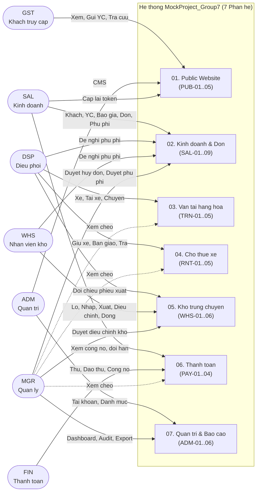

# Bước 1 — Tổng quan Hệ thống, Actors, Use Cases & Ma trận Phân quyền (RBAC)

- **Dự án**: `MockProject_Group7` — Hệ thống Quản lý Vận tải, Cho thuê xe & Kho bãi Trung chuyển
- **Giai đoạn**: Phần 1 (Software Core) — Bước Lớn 1 (theo [Template2_RDS Document.docx](file:///D:/Ber/OJT-CPL/FinalProject/docs/99_Support_Documents/2_SWP391/Template2_RDS%20Document.docx))
- **Tài liệu nguồn đối chiếu**: `docs/01_SRS/baseline/00_Overall_SRS.pdf` .. `08_Acceptance_and_Traceability.pdf`
- **Stack Software**: Backend Python (`FastAPI`, `SQLAlchemy 2.0`, `Alembic`), Database `PostgreSQL`, Frontend `React + TypeScript`.

---

## 1. Mục tiêu, Phạm vi & Giả định Nghiệp vụ

### 1.1. Mục tiêu hệ thống
Hỗ trợ công ty tiếp nhận nhu cầu, lập/quản lý báo giá theo phiên bản, xác nhận đơn dịch vụ, tổ chức thực hiện vận hành và theo dõi thu tiền cho **3 loại dịch vụ chính** (Vận tải hàng hóa nội địa, Cho thuê xe không kèm tài xế, Kho bãi trung chuyển ngắn hạn). Nhân viên có thẩm quyền kiểm tra dữ liệu và ra quyết định nghiệp vụ; backend thực thi nghiêm ngặt các kiểm soát, trạng thái và quyền đã phê duyệt.

### 1.2. Giả định nghiệp vụ cố định (SRS 00 — Mục 1.1)
1. Quy mô **1 công ty, 1 đội xe, 1 kho trung chuyển**; giao dịch chính xác đến **đồng (`VND`)**, múi giờ chuẩn **`Asia/Ho_Chi_Minh`**.
2. **Vận tải nội địa**: 1 điểm lấy và 1 điểm giao trên mỗi chuyến; mỗi đơn vận tải có đúng **1 chuyến** (`TransportTrip`).
3. **Cho thuê xe**: không kèm tài xế; mỗi đơn thuê có đúng **1 xe** và 1 khoảng thời gian đặt trước (`RentalRecord`).
4. **Kho lưu ngắn hạn**: quản lý theo **lô** (`WarehouseLot`) và **dòng hàng** (`LotLine`) theo đơn vị đếm cố định (kiện/thùng/pallet); chưa quản lý vị trí kệ, nhiệt độ hoặc hàng nguy hiểm.
5. Mỗi đơn (`ServiceOrder`) có **1 loại dịch vụ chính**. Đơn kho và đơn vận tải có thể liên kết cùng lô hàng nhưng có trạng thái vận hành và khoản phải thu tách biệt hoàn toàn.
6. Khách hàng không cần tài khoản đăng nhập để gửi yêu cầu hay tra cứu công khai; nhân viên `SAL` ghi nhận việc khách chấp thuận báo giá kèm bằng chứng.
7. Chứng từ giao dịch là chứng từ nghiệp vụ điện tử bất biến sau xác nhận, có lịch sử và phân quyền truy cập; khoản thu được `FIN` ghi nhận thủ công sau khi đối chiếu chứng từ, chưa tích hợp trực tiếp ngân hàng.

### 1.3. Ngoài phạm vi (Out of Scope — SRS 00 — Mục 1.2)
- GPS thời gian thực & thuật toán tối ưu tuyến / tự tính thời gian tuyến.
- Ứng dụng di động riêng cho khách hàng hoặc tài xế (tài xế chưa có tài khoản riêng, `DSP` nhập cập nhật).
- Nhiều chi nhánh / nhiều kho / tách dữ liệu theo phòng ban hoặc người phụ trách.
- Kế toán tổng hợp, xuất hóa đơn điện tử, tự động tính thuế VAT.
- Cổng thanh toán trực tuyến / đối soát ngân hàng tự động / phát lệnh hoàn tiền ngân hàng / quản lý tạm ứng-đặt cọc.
- Tích hợp trực tiếp hệ thống đối tác / gửi email tự động từ hệ thống.
- Hợp đồng đa dịch vụ phức tạp, tự động quyết định giá (AI/pricing engine), quản lý bảo dưỡng phương tiện đầy đủ.

---

## 2. Tác nhân Hệ thống (Actors — 7 Vai trò)

Theo [Template2_RDS](file:///D:/Ber/OJT-CPL/FinalProject/docs/99_Support_Documents/2_SWP391/Template2_RDS%20Document.docx) (Mục I.1.1) và `00_Overall_SRS.pdf` (Mục 2):

| # | Mã vai trò | Tên vai trò | Loại | Mô tả quyền & phạm vi nghiệp vụ trong hệ thống |
|---|---|---|---|---|
| 1 | `GST` | Khách truy cập (Guest) | External | Xem nội dung công khai (`PUBLISHED`), gửi yêu cầu dịch vụ từ website, tra cứu tiến độ 1 hồ sơ bằng mã + token hợp lệ (`BR-18`). |
| 2 | `SAL` | Kinh doanh (Sales) | Internal | Quản lý khách hàng, tiếp nhận/làm rõ yêu cầu, thu hồi/cấp lại token tra cứu, lập/phát hành/ghi nhận phản hồi báo giá, tạo đơn dịch vụ, đề nghị phụ phí/hủy đơn, xem tiến độ và số dư đơn; **không** xác nhận giao nhận vận hành hoặc thu tiền. |
| 3 | `DSP` | Điều phối (Dispatcher) | Internal | Quản lý đội xe & tài xế, tra cứu lịch dùng chung, giữ/đổi/bỏ giữ xe và phân công tài xế cho đơn vận tải/thuê xe, cập nhật mốc nhận-giao-trả xe, lập biên bản, ghi nhận sự cố, đề nghị phụ phí vận tải/thuê; **không** sửa báo giá đã chấp thuận. |
| 4 | `WHS` | Nhân viên kho (Warehouse Staff) | Internal | Xem đơn kho, tạo lô & dòng hàng, lập/xác nhận phiếu nhập/xuất kho từng phần, đề nghị điều chỉnh phiếu đã xác nhận, đề nghị phụ phí kho, kết thúc đơn kho; chỉ xem thông tin đơn vận tải liên kết cần cho giao nhận (không mở toàn bộ dữ liệu khách). |
| 5 | `FIN` | Theo dõi thanh toán (Finance) | Internal | Xem đơn đã chốt và giá trị phải thu, ghi nhận khoản thu (`CASH`/`BANK_TRANSFER`), đảo toàn bộ khoản thu nhập sai, cập nhật ngày đến hạn (có lý do & audit), tra cứu công nợ; **không** sửa báo giá, phụ phí hay trạng thái vận hành. |
| 6 | `MGR` | Quản lý (Manager) | Internal | Xem toàn bộ nghiệp vụ, dashboard công ty và audit log; phê duyệt/từ chối phụ phí (`SAL-08`), phê duyệt điều chỉnh chứng từ kho (`WHS-05`), chốt hủy đơn đủ điều kiện `BR-15` (`SAL-09`). **Không** mặc nhiên thay thế thao tác nghiệp vụ của `SAL/DSP/WHS/FIN` nếu chưa được gán vai trò đó. |
| 7 | `ADM` | Quản trị hệ thống (Admin) | Internal | Quản lý tài khoản, khóa/mở, đặt lại mật khẩu, gán/thu hồi vai trò (`ADM-01/02`), quản lý danh mục dùng chung (`ADM-03`) và CMS nội dung website (`PUB-05`). **Không** mặc nhiên có quyền sửa giao dịch kinh doanh, thu tiền, xuất kho hay phân xe. |

### Nguyên tắc kiểm soát vai trò (RBAC Invariants)
- **Đa vai trò**: Một tài khoản có thể được gán nhiều vai trò; quyền hiệu lực = **hợp (union)** của tất cả vai trò đang được gán.
- **Kiểm tra tại Backend (`NFR-01`)**: Mọi API nội bộ phải xác thực phiên còn hiệu lực và kiểm tra quyền trực tiếp ở tầng Backend (kể cả truy cập theo ID trực tiếp / chống IDOR). Ẩn nút trên UI chỉ là hỗ trợ UX, **không** thay thế kiểm soát quyền.
- **Tài khoản ADM cuối cùng (`ADM-02`)**: Hệ thống chặn mọi thao tác khóa hoặc thu hồi quyền `ADM` của tài khoản `ADM` đang hoạt động cuối cùng.

---

## 3. Sơ đồ & Danh mục Use Cases Tổng thể

### 3.1. Sơ đồ Quan hệ Actors – Phân hệ (Use Case Overview)

### 3.2. Danh sách 40 Use Cases / User Stories (39 `Must` + 1 `Should`)

| ID | Phân hệ | Tên Use Case / User Story | Primary Actor | Secondary Actors | Priority | Tài liệu gốc |
|---|---|---|---|---|---|---|
| `PUB-01` | Public Website | Xem thông tin công ty và dịch vụ | `GST` | — | Must | `01_Public_Website.pdf` |
| `PUB-02` | Public Website | Gửi yêu cầu dịch vụ | `GST` | — | Must | `01_Public_Website.pdf` |
| `PUB-03` | Public Website | Nhận mã và hướng dẫn sau khi gửi | `GST` | — | Must | `01_Public_Website.pdf` |
| `PUB-04` | Public Website | Tra cứu tiến độ hồ sơ công khai | `GST` | `SAL` (cấp lại token) | Must | `01_Public_Website.pdf` |
| `PUB-05` | Public Website | Quản lý nội dung công khai (CMS) | `ADM` | — | Must | `01_Public_Website.pdf` |
| `SAL-01` | Kinh doanh | Quản lý hồ sơ khách hàng | `SAL` | — | Must | `02_Sales_and_Service_Orders.pdf` |
| `SAL-02` | Kinh doanh | Tiếp nhận và làm rõ yêu cầu | `SAL` | `GST` | Must | `02_Sales_and_Service_Orders.pdf` |
| `SAL-03` | Kinh doanh | Phân công phụ trách và lưu trao đổi | `SAL` | — | Must | `02_Sales_and_Service_Orders.pdf` |
| `SAL-04` | Kinh doanh | Lập và kiểm tra báo giá | `SAL` | — | Must | `02_Sales_and_Service_Orders.pdf` |
| `SAL-05` | Kinh doanh | Quản lý phiên bản và phản hồi báo giá | `SAL` | — | Must | `02_Sales_and_Service_Orders.pdf` |
| `SAL-06` | Kinh doanh | Xác nhận báo giá và tạo đơn dịch vụ | `SAL` | `DSP` / `WHS` (khởi tạo hồ sơ) | Must | `02_Sales_and_Service_Orders.pdf` |
| `SAL-07` | Kinh doanh | Theo dõi và cập nhật ghi chú đơn | `SAL` | `DSP`, `WHS`, `FIN` | Must | `02_Sales_and_Service_Orders.pdf` |
| `SAL-08` | Kinh doanh | Ghi nhận đề nghị và duyệt phụ phí | `SAL` / `DSP` / `WHS` | `MGR` (duyệt) | Must | `02_Sales_and_Service_Orders.pdf` |
| `SAL-09` | Kinh doanh | Đề nghị và chốt hủy đơn trước thực hiện | `MGR` | `SAL` (đề nghị) | Must | `02_Sales_and_Service_Orders.pdf` |
| `TRN-01` | Vận tải | Quản lý đội xe và tài xế | `DSP` | — | Must | `03_Freight_Transportation.pdf` |
| `TRN-02` | Vận tải | Điều phối và thay đổi phân công chuyến | `DSP` | — | Must | `03_Freight_Transportation.pdf` |
| `TRN-03` | Vận tải | Ghi nhận nhận hàng và đang vận chuyển | `DSP` | — | Must | `03_Freight_Transportation.pdf` |
| `TRN-04` | Vận tải | Xác nhận giao hàng và hoàn tất chuyến | `DSP` | — | Must | `03_Freight_Transportation.pdf` |
| `TRN-05` | Vận tải | Quản lý sự cố và chậm tiến độ vận tải | `DSP` | `SAL`, `MGR` | Must | `03_Freight_Transportation.pdf` |
| `RNT-01` | Cho thuê xe | Tra cứu và giữ xe cho đơn thuê | `DSP` | — | Must | `04_Vehicle_Rental.pdf` |
| `RNT-02` | Cho thuê xe | Đổi xe/khung giờ hoặc bỏ giữ xe | `DSP` | — | Must | `04_Vehicle_Rental.pdf` |
| `RNT-03` | Cho thuê xe | Lập biên bản bàn giao xe | `DSP` | — | Must | `04_Vehicle_Rental.pdf` |
| `RNT-04` | Cho thuê xe | Ghi nhận trả xe và đối chiếu | `DSP` | — | Must | `04_Vehicle_Rental.pdf` |
| `RNT-05` | Cho thuê xe | Hoàn tất hồ sơ thuê xe | `DSP` | `MGR` (duyệt phụ phí) | Must | `04_Vehicle_Rental.pdf` |
| `WHS-01` | Kho bãi | Tạo và quản lý lô hàng từ đơn kho | `WHS` | — | Must | `05_Transshipment_Warehouse.pdf` |
| `WHS-02` | Kho bãi | Lập và xác nhận phiếu nhập kho | `WHS` | — | Must | `05_Transshipment_Warehouse.pdf` |
| `WHS-03` | Kho bãi | Lập và xác nhận phiếu xuất từng phần | `WHS` | — | Must | `05_Transshipment_Warehouse.pdf` |
| `WHS-04` | Kho bãi | Tra cứu tồn kho và liên kết vận tải | `WHS` / `DSP` | — | Must | `05_Transshipment_Warehouse.pdf` |
| `WHS-05` | Kho bãi | Đề nghị và duyệt điều chỉnh chứng từ kho | `WHS` | `MGR` (duyệt) | Must | `05_Transshipment_Warehouse.pdf` |
| `WHS-06` | Kho bãi | Kết thúc dịch vụ kho | `WHS` | — | Must | `05_Transshipment_Warehouse.pdf` |
| `PAY-01` | Thanh toán | Xác định và xem khoản phải thu của đơn | `FIN` | `SAL`, `MGR` | Must | `06_Payment_Tracking.pdf` |
| `PAY-02` | Thanh toán | Ghi nhận giao dịch thu tiền | `FIN` | — | Must | `06_Payment_Tracking.pdf` |
| `PAY-03` | Thanh toán | Đảo toàn bộ khoản thu nhập sai | `FIN` | — | Must | `06_Payment_Tracking.pdf` |
| `PAY-04` | Thanh toán | Tra cứu công nợ, lịch sử và cập nhật hạn | `FIN` / `MGR` | `SAL` (cập nhật hạn) | Must | `06_Payment_Tracking.pdf` |
| `ADM-01` | Quản trị | Đăng nhập và quản lý phiên nội bộ | `SAL/DSP/WHS/FIN/MGR/ADM` | — | Must | `07_Administration_and_Reporting.pdf` |
| `ADM-02` | Quản trị | Quản lý tài khoản và phân quyền | `ADM` | — | Must | `07_Administration_and_Reporting.pdf` |
| `ADM-03` | Quản trị | Quản lý danh mục dùng chung | `ADM` | — | Must | `07_Administration_and_Reporting.pdf` |
| `ADM-04` | Quản trị | Tra cứu lịch sử thao tác (Audit Log) | `MGR` | — | Must | `07_Administration_and_Reporting.pdf` |
| `ADM-05` | Quản trị | Xem dashboard vận hành và tài chính | `MGR` | `SAL/DSP/WHS/FIN/ADM` (theo phạm vi) | Must | `07_Administration_and_Reporting.pdf` |
| `ADM-06` | Quản trị | Xuất danh sách báo cáo CSV | `MGR` | Nhân viên được cấp quyền | Should | `07_Administration_and_Reporting.pdf` |

---

## 4. Ma trận Phân quyền Màn hình & API (Screen & API Authorization Matrix)

Ký hiệu: **X** = Được phép thao tác đầy đủ trong phạm vi quy tắc; **R** = Chỉ xem (Read-only); **R*** = Chỉ xem dữ liệu hạn chế/liên kết cần cho phối hợp (`BR-18` hoặc scoped view); **—** = Cấm truy cập (Backend trả `401`/`403`).

| Phân hệ / Nhóm chức năng & Thao tác | `GST` | `SAL` | `DSP` | `WHS` | `FIN` | `MGR` | `ADM` | Ràng buộc kiểm soát (`NFR-01` / `BR-*`) |
|---|---|---|---|---|---|---|---|---|
| **PUB: Website công khai** | | | | | | | | |
| Xem trang công khai (`PUBLISHED`), gửi yêu cầu, nhận mã/token | X | — | — | — | — | — | — | `DRAFT/HIDDEN` bị chặn; rate limit `5/IP/10m` (`NFR-12`) |
| Tra cứu hồ sơ công khai (mã + token) | X | — | — | — | — | — | — | Chỉ trả dữ liệu `BR-18`; khóa sau 10 lần sai/15m (`NFR-03`) |
| CMS: tạo/sửa/ẩn/xuất bản nội dung công khai | — | — | — | — | — | — | X | Không cho ẩn cả 3 dịch vụ hoặc xóa liên hệ cuối (`PUB-05`) |
| **SAL: Khách hàng, Yêu cầu, Báo giá & Đơn** | | | | | | | | |
| Tạo/sửa/ngừng dùng hồ sơ Khách hàng | — | X | — | — | — | R | — | Cảnh báo trùng SĐT/email, không tự gộp (`SAL-01`); không hard delete (`BR-16`) |
| Tiếp nhận/nhập yêu cầu nội bộ, làm rõ, phân công SAL, ghi trao đổi | — | X | — | — | — | R | — | Chỉ phân công người có role `SAL` đang `ACTIVE` (`SAL-03`) |
| Thu hồi và cấp lại token tra cứu cho khách | — | X | — | — | — | — | — | Ghi cách xác minh & lý do; token mới hiển thị 1 lần (`SAL-02`) |
| Lập/sửa `DRAFT`, phát hành `SENT`, ghi nhận `ACCEPTED`/`REJECTED` | — | X | — | — | — | R | — | Chỉ bản `SENT` chưa quá hạn & chưa `SUPERSEDED` (`BR-04`) |
| Xác nhận báo giá → Tạo đơn dịch vụ (`ServiceOrder`) | — | X | — | — | — | R | — | Atomic + Idempotent (`BR-05`, `NFR-05`) |
| Xem đơn dịch vụ, sửa ghi chú liên hệ (`SAL-07`) | — | X | R* | R* | R* | R | — | `DSP/WHS/FIN` chỉ xem đơn liên quan phạm vi nghiệp vụ |
| Đề nghị phụ phí (`PENDING`) | — | X | X | X | — | — | — | Chỉ đề nghị trên loại đơn mình xử lý (`SAL-08`); chặn sau `COMPLETED/CANCELLED` |
| Phê duyệt / Từ chối phụ phí | — | — | — | — | — | X | — | Chỉ `APPROVED` mới cộng vào phải thu (`BR-13`) |
| Đề nghị hủy đơn trước thực hiện | — | X | — | — | — | X | — | Kiểm tra `BR-15` và không còn phụ phí `PENDING/APPROVED` |
| Chốt hủy đơn hợp lệ & giải phóng lịch giữ | — | — | — | — | — | X | — | Bắt buộc nhập lý do (`SAL-09`, `BR-15`) |
| **TRN & RNT: Xe, Tài xế, Điều phối & Thuê xe** | | | | | | | | |
| Tạo/sửa/ngừng dùng Xe & Tài xế (`TRN-01`) | — | — | X | — | — | R | — | Chặn ngừng dùng nếu còn lịch tương lai hoặc đang sử dụng |
| Xem lịch dùng chung & giữ/đổi/gỡ xe & tài xế (`TRN-02`, `RNT-01/02`) | — | R* | X | — | — | R | — | Check trùng `[start, end)` cả `TRN`+`RNT` (`BR-07/08`, `NFR-05`) |
| Cập nhật nhận/vận chuyển/giao hàng, sự cố, hoàn tất chuyến (`TRN-03..05`) | — | R* | X | R* | — | R | — | Đúng thứ tự trạng thái; giao hàng bắt buộc file bằng chứng (`NFR-07`) |
| Bàn giao, nhận lại, hoàn tất hồ sơ thuê xe (`RNT-03..05`) | — | R* | X | — | — | R | — | `km_return >= km_handover`; không giao xe khi chưa trả thực tế (`BR-09`) |
| **WHS: Kho bãi trung chuyển** | | | | | | | | |
| Tạo/sửa dòng hàng lô (trước nhập), lập/xác nhận phiếu nhập & xuất (`WHS-01..03`) | — | R* | R* | X | — | R | — | Xuất phải lock & chống tồn âm (`BR-11`, `NFR-05`) |
| Liên kết phiếu xuất với đơn vận tải cùng khách (`WHS-04`) | — | — | R* | X | — | R | — | Cùng khách, chưa `CANCELLED`, điểm lấy là kho |
| Đề nghị điều chỉnh chứng từ kho đã `POSTED` (`WHS-05`) | — | — | — | X | — | — | — | Nhập/xuất điều chỉnh có liên kết phiếu nguồn (`BR-12`) |
| Phê duyệt / Từ chối điều chỉnh chứng từ kho (`WHS-05`) | — | — | — | — | — | X | — | Kiểm tra đủ tồn và số lượng còn điều chỉnh được (`BR-12`) |
| Xác nhận kết thúc dịch vụ kho (`WHS-06`) | — | R* | — | X | — | R | — | Mọi dòng tồn = 0, không còn `DRAFT` / điều chỉnh chờ / phụ phí `PENDING` |
| **PAY: Theo dõi thanh toán** | | | | | | | | |
| Xem khoản phải thu, số dư, chuỗi thu/đảo (`PAY-01`, `PAY-04`) | — | R | R* | R* | X | R | — | `GST` cấm xem số dư (`BR-18`) |
| Ghi nhận khoản thu tiền (`CASH`/`BANK_TRANSFER`) (`PAY-02`) | — | — | — | — | X | — | — | Không thu vượt số dư (`BR-13`), không thu đơn `CANCELLED` |
| Đảo toàn bộ khoản thu nhập sai (`PAY-03`) | — | — | — | — | X | — | — | Tối đa 1 lần/khoản gốc (`BR-14`); nhập lý do |
| Cập nhật ngày đến hạn thanh toán (`PAY-04`) | — | X | — | — | X | — | — | Khi đơn chưa hủy; có lý do & audit; không che lịch sử quá hạn |
| **ADM: Quản trị, Audit & Báo cáo** | | | | | | | | |
| Đăng nhập cổng nội bộ, đổi mật khẩu, đăng xuất (`ADM-01`) | — | X | X | X | X | X | X | Tài khoản `ACTIVE`; khóa 15m sau 5 lần sai; idle timeout 30m |
| Tạo/khóa/đặt lại mật khẩu/gán-thu hồi vai trò (`ADM-02`) | — | — | — | — | — | — | X | Không khóa/bỏ quyền `ADM` hoạt động cuối cùng |
| Quản lý danh mục dùng chung: loại xe, đơn vị đếm (`ADM-03`) | — | R | R | R | R | R | X | Không đổi ý nghĩa đơn vị đã giao dịch (`BR-10`) |
| Tra cứu Audit Log (`ADM-04`) | — | — | — | — | — | X | — | Chỉ đọc (append-only); không UI/API sửa/xóa; không chứa secret/token |
| Xem Dashboard vận hành & tài chính (`ADM-05`) | — | R* | R* | R* | R* | X | R* | Mỗi vai trò chỉ thấy chỉ số thuộc phạm vi quyền |
| Xuất báo cáo CSV (`ADM-06` — Should) | — | R* | R* | R* | R* | X | — | Trong đúng quyền & bộ lọc; chống CSV formula injection |

---

## 5. Chức năng Không giao diện (Non-UI Functions — `Template2_RDS` I.2.4)

| # | Mã / Nhóm | Chức năng hệ thống | Cơ chế thực thi & Quy tắc liên quan |
|---|---|---|---|
| 1 | `SYS-01` | Đánh giá hết hạn báo giá | Báo giá `SENT` có hiệu lực tới `23:59:59` ngày hết hạn theo `Asia/Ho_Chi_Minh`. Khi đọc hoặc chấp thuận/từ chối quá hạn, hệ thống tự đánh dấu/hiển thị `EXPIRED` và chặn thao tác (`BR-04`). |
| 2 | `SYS-02` | Tính cờ quá hạn vận hành & thanh toán | Tính động theo đồng hồ hệ thống (`Asia/Ho_Chi_Minh`): vận tải/thuê xe quá giờ kết thúc mà chưa giao/trả bật cờ quá hạn (`TRN-05`, `RNT-04`); đơn chưa hủy có `current_date > payment_due_date` và `remaining > 0` bật cờ quá hạn thanh toán (`PAY-04`). |
| 3 | `SYS-03` | Quản lý phiên & vô hiệu hóa tức thì | Kiểm tra `session_status` + `user_status` + `role_version` tại Backend trên mọi request; tự hết hạn sau 30 phút không hoạt động; khóa user / thu hồi role / đổi mật khẩu / đăng xuất thu hồi phiên ngay lập tức (`ADM-01`, `NFR-02`). |
| 4 | `SYS-04` | Token tra cứu công khai & Rate Limiting | Sinh token ngẫu nhiên CSPRNG >= 128 bit, lưu hash trong DB, không ghi URL/log (`NFR-03`). Chặn tạm tra cứu sau 10 lần sai/IP/15 phút; chặn đăng nhập sai sau 5 lần/account/15 phút; chặn gửi yêu cầu mới sau 5 lần/IP/10 phút (`NFR-12`). |
| 5 | `SYS-05` | Chống trùng lặp & Xử lý đồng thời | Middleware/Service kiểm tra `idempotency_key` (`PUB-02`, `SAL-06`, `WHS-02/03`, `PAY-02/03`) và DB transaction locking (`SELECT ... FOR UPDATE` + `version`) chống double-booking, tồn âm, thu vượt (`NFR-05`). |
| 6 | `SYS-06` | Làm sạch nội dung & Bảo vệ File Upload | Sanitize HTML/script đầu vào và nội dung CMS (`NFR-12`); kiểm tra MIME/magic bytes (`PDF/JPG/PNG`) & dung lượng `<= 5MB` ở backend, đổi tên file lưu an toàn (`NFR-07`). |
| 7 | `SYS-07` | Audit Log & Technical Logging | Ghi `audit_logs` bất biến kèm `before/after/actor/time/reason` cho mọi thay đổi quan trọng (`BR-17`); gắn `correlation_id` vào log kỹ thuật để tra lỗi, lọc bỏ password/token/secret (`NFR-08`). |
| 8 | `SYS-08` | Sao lưu định kỳ & Health Check | Endpoint `/health` kiểm tra kết nối app/DB (`NFR-11`); script/cron sao lưu PostgreSQL + `data/uploads/` hằng ngày bảo đảm `RPO <= 24h`, `RTO <= 8h` (`NFR-09`). |

---

## 6. Kiểm soát Tài liệu Nghiệp vụ (`08_Acceptance_and_Traceability.pdf` Mục 8)

Chỉ các tài liệu phiên bản **`ACTIVE`** được phép làm nguồn quy tắc nghiệp vụ cho SRS, Code và Test Case. Các bản **`SUPERSEDED`** dưới đây chỉ lưu lịch sử kiểm toán, **tuyệt đối không** dùng làm nguồn kỳ vọng hành vi hệ thống:

| Mã tài liệu | Bản `SUPERSEDED` (Cấm dùng cho logic vận hành) | Bản `ACTIVE` (Bắt buộc áp dụng) |
|---|---|---|
| `POL-COM-003` | `v1.0` | **`v1.1 ACTIVE`** |
| `POL-TRN-001` | `v1.0`, `v1.1` | **`v2.0 ACTIVE`** |
| `SOP-WHS-001` | `v1.0` | **`v1.1 ACTIVE`** |
| `SOP-ADM-001` | `v1.0` | **`v1.1 ACTIVE`** |

---

## 7. Checklist Verify Gate 1A (Static Review)

- [x] Đủ 7 Actors (`GST`, `SAL`, `DSP`, `WHS`, `FIN`, `MGR`, `ADM`) và đúng nguyên tắc đa vai trò / kiểm soát backend.
- [x] Đủ toàn bộ **40 User Stories** (39 `Must` + 1 `Should` `ADM-06`) từ 7 file SRS phân hệ (`01`..`07`).
- [x] Ma trận phân quyền bao phủ toàn bộ thao tác đọc/ghi/duyệt/hủy và tách bạch ranh giới `ADM` (không thu tiền/xuất kho), `MGR` (không tự thay `SAL/DSP/WHS/FIN`), `GST` (tuân thủ `BR-18`).
- [x] Đủ 8 nhóm Non-UI Functions đáp ứng `BR-04/17/18` và `NFR-01/02/03/05/07/08/09/11/12`.
- [x] Khẳng định danh mục tài liệu `ACTIVE` vs `SUPERSEDED` theo `SRS/08`.
