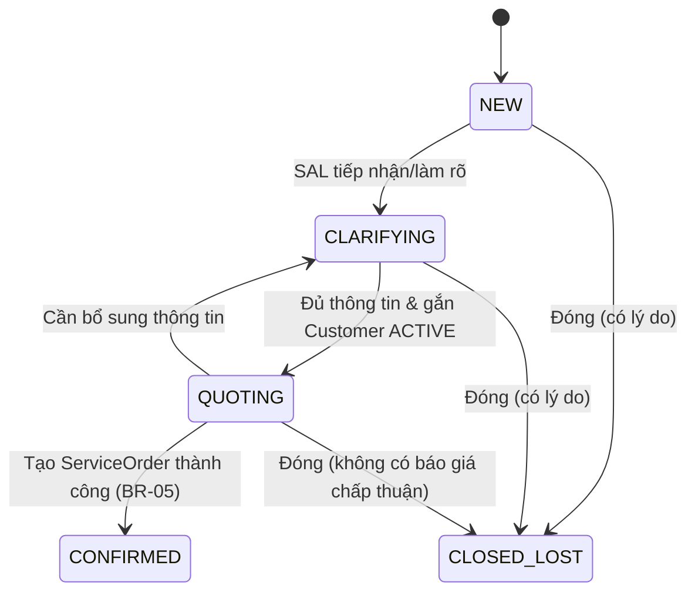
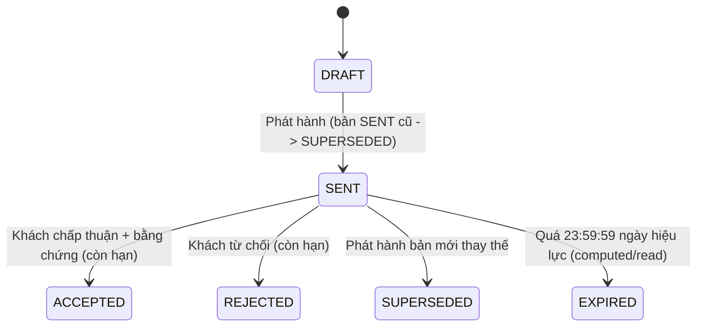
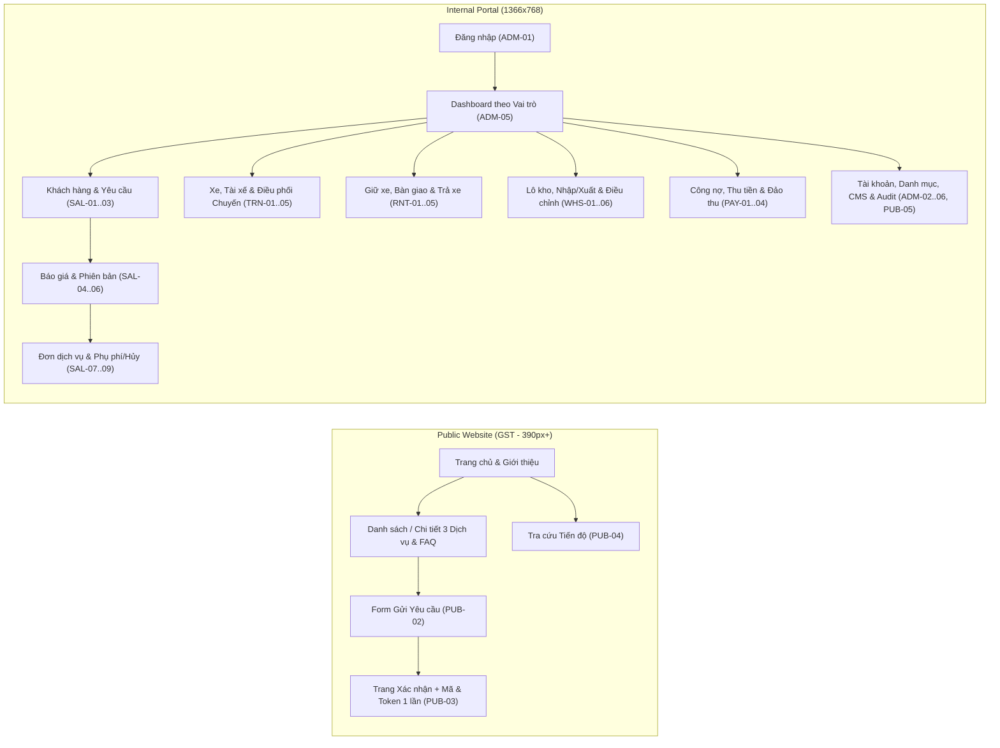

# Bước 2 — Đặc tả 40 User Stories, State Machines & Screens Flow

- **Dự án**: `MockProject_Group7` — Hệ thống Quản lý Vận tải, Cho thuê xe & Kho bãi Trung chuyển
- **Giai đoạn**: Phần 1 (Software Core) — Bước Lớn 2 (theo [Template2_RDS Document.docx](file:///D:/Ber/OJT-CPL/FinalProject/docs/99_Support_Documents/2_SWP391/Template2_RDS%20Document.docx) & `1_SWR302`)
- **Tài liệu nguồn**: `docs/01_SRS/baseline/00_Overall_SRS.pdf` .. `08_Acceptance_and_Traceability.pdf`

---

## 1. Sơ đồ Chuyển trạng thái Toàn hệ thống (State Machines — SRS 00 Mục 4)

Backend chỉ cho phép các chuyển đổi hợp lệ dưới đây; mọi thao tác ngoài luồng phải bị từ chối (`400`/`409`/`422`) và không làm thay đổi dữ liệu.

### 1.1. Yêu cầu (`ServiceRequest`) & Báo giá (`Quote`)

- **Bất biến**: Chỉ `DRAFT` được sửa; `REJECTED`/`EXPIRED` có thể làm cơ sở tạo `DRAFT` phiên bản mới; sau khi đã có `ServiceOrder`, không sửa báo giá chốt và không hạ `ServiceRequest` khỏi `CONFIRMED`.

### 1.2. Đơn dịch vụ (`ServiceOrder`) & Chi tiết Vận hành (`TransportTrip` / `RentalRecord` / `Warehouse`)

> [!IMPORTANT]
> Trạng thái chung (`general_status`) của `ServiceOrder` và trạng thái chi tiết (`detail_status`) của phân hệ vận hành là **2 trường độc lập**, không dùng chung một trường để chứa hai ý nghĩa (`00_Overall_SRS.pdf` Mục 4.2).

- **Trạng thái chung (`ServiceOrder.general_status`)**: `CONFIRMED` → `IN_PROGRESS` → `COMPLETED` (hoặc `CONFIRMED` → `CANCELLED` nếu thỏa `BR-15` và không còn phụ phí `PENDING`/`APPROVED`). Không mở lại đơn `COMPLETED`/`CANCELLED`.

| Phân hệ | Chuỗi trạng thái chi tiết hợp lệ | Điều kiện kích hoạt & Chuyển đổi ngược/hủy |
|---|---|---|
| **Vận tải (`TransportTrip`)** | `UNASSIGNED` → `ASSIGNED` → `PICKED_UP` → `IN_TRANSIT` → `DELIVERED` → `COMPLETED` | `PICKED_UP` đẩy đơn sang `IN_PROGRESS`; `DELIVERED` cần file bằng chứng (`NFR-07`); `COMPLETED` cần đủ bằng chứng & hết phụ phí `PENDING`. `ASSIGNED` → `UNASSIGNED` khi gỡ lịch trước nhận hàng. Hủy đơn (`BR-15`) đưa bản ghi về `CANCELLED`. |
| **Thuê xe (`RentalRecord`)** | `UNASSIGNED` → `RESERVED` → `HANDED_OVER` → `RETURNED` → `COMPLETED` | `HANDED_OVER` đẩy đơn sang `IN_PROGRESS`; `RETURNED` giải phóng xe tại thời điểm thực tế; `COMPLETED` khi đủ 2 biên bản & hết phụ phí `PENDING`. `RESERVED` → `UNASSIGNED` khi bỏ giữ xe trước bàn giao. Hủy đơn đưa bản ghi về `CANCELLED`. |
| **Kho (`WarehouseLot`)** | `WAITING_RECEIPT` → `IN_STORAGE` → `COMPLETED` | Phiếu nhập `POSTED` đầu tiên đẩy đơn sang `IN_PROGRESS` và lô sang `IN_STORAGE`. Chỉ đóng `COMPLETED` khi mọi dòng tồn = 0, không còn phiếu `DRAFT`/điều chỉnh chờ/phụ phí `PENDING` và `WHS` xác nhận kết thúc. Không tự đóng khi tồn về 0. |
| **Phiếu kho (`WarehouseDocument`)** | `DRAFT` → `POSTED` hoặc `DRAFT` → `CANCELLED` | Bản `DRAFT` không đổi tồn. Chỉ `POSTED` mới cộng/trừ tồn; phiếu điều chỉnh `POSTED` giữ `source_doc_id`. Không sửa/xóa phiếu đã `POSTED`. |
| **Thanh toán (`Payment`)** | `POSTED` → `REVERSED` | Đảo toàn bộ 1 lần duy nhất (`BR-14`); không đảo khoản đảo. Trạng thái thanh toán đơn: `UNPAID` (`paid=0`), `PARTIALLY_PAID` (`0<paid<receivable`), `PAID` (`paid=receivable`), `NOT_APPLICABLE` (đơn `CANCELLED`). |

---

## 2. Screens Flow Sơ bộ (Public Website & Internal Portal)

---

## 3. Đặc tả Chi tiết 40 User Stories (Theo 7 Phân hệ)

> [!NOTE]
> Mọi tài liệu tham chiếu dưới đây đều là phiên bản **`ACTIVE`** theo `08_Acceptance_and_Traceability.pdf` Mục 8 (`POL-COM-003 v1.1`, `POL-TRN-001 v2.0`, `SOP-WHS-001 v1.1`, `SOP-ADM-001 v1.1`). Các bản `SUPERSEDED` bị loại bỏ hoàn toàn khỏi đặc tả chức năng.

### 3.1. Phân hệ 01: Public Website (`PUB-01` .. `PUB-05`)

| Mã & Tên | User Story & Tiêu chí chấp nhận (Given–When–Then) | Flow / Ngoại lệ chính | `BR` / `NFR` & Tài liệu `ACTIVE` |
|---|---|---|---|
| **`PUB-01`** Xem thông tin công ty & dịch vụ *(Must)* | Là khách truy cập, tôi muốn hiểu công ty cung cấp gì và cách liên hệ để chọn dịch vụ phù hợp. - **Given** nội dung `PUBLISHED`, **When** truy cập không đăng nhập, **Then** xem được trang chủ, giới thiệu, 3 dịch vụ (giá chỉ ghi tham khảo), loại xe/tải trọng, kho, quy trình, FAQ, liên hệ và đi đến form đúng loại dịch vụ. - **Given** nội dung `DRAFT`/`HIDDEN`, **When** truy cập trực tiếp URL, **Then** không hiển thị. | Chọn từ trang dịch vụ tự pre-select loại dịch vụ ở `PUB-02`. | `NFR-06` (390px/1366px), `NFR-12`; `ORG-COM-001`, `GUIDE-PUB-001`, `FAQ-PUB-001` |
| **`PUB-02`** Gửi yêu cầu dịch vụ *(Must)* | Là khách hàng, tôi muốn mô tả nhu cầu để công ty tiếp nhận và tư vấn. - **Given** form hợp lệ (chung + trường riêng theo Vận tải/Thuê xe/Kho + tick xác nhận dùng dữ liệu), **When** gửi, **Then** lưu `ServiceRequest` trạng thái `NEW`, nguồn `WEBSITE`; chưa tự tạo `Customer`, báo giá, đơn hay giữ xe. - **Given** thiếu trường/sai ngày/số lượng âm/chưa xác nhận dữ liệu, **When** gửi, **Then** chỉ rõ trường lỗi và giữ nguyên dữ liệu hợp lệ. - **Given** bấm gửi lại cùng khóa thao tác do mạng chậm, **Then** chỉ tạo 1 hồ sơ. | Chặn nếu vượt `5 yêu cầu/IP/10 phút` hoặc chứa script XSS. | `BR-01`, `BR-02`, `NFR-05`, `NFR-12`; `POL-PUB-001`, `POL-COM-001` |
| **`PUB-03`** Nhận mã và hướng dẫn sau gửi *(Must)* | Là khách vừa gửi yêu cầu, tôi muốn nhận xác nhận để theo dõi về sau. - **Given** gửi thành công, **Then** hiển thị mã yêu cầu, thời điểm, loại dịch vụ, tóm tắt, liên hệ công ty và **token tra cứu 128-bit** (hiển thị 1 lần, không gắn vào URL, nêu rõ đã tiếp nhận chứ chưa giữ xe/chốt giá). - **Given** lưu thất bại, **Then** không hiển thị mã giả. | Cho phép thử lại với khóa mới nếu lỗi hệ thống. | `NFR-03`, `BR-01`; `POL-PUB-001` |
| **`PUB-04`** Tra cứu tiến độ công khai *(Must)* | Là khách hàng, tôi muốn tra cứu hồ sơ bằng mã yêu cầu/đơn + token để biết tiến độ. - **Given** mã + token đúng, **Then** hiển thị trạng thái yêu cầu, mã đơn (nếu có), trạng thái công khai và mốc thực tế (không giả lập GPS). - **Given** mã/token sai, hết hạn hoặc bị thu hồi, **Then** trả thông báo chung, không lộ mã tồn tại hay chủ sở hữu. | Khóa tạm tra cứu sau **10 lần sai/IP/15 phút** (vẫn cho xem trang giới thiệu công khai). | `BR-18`, `NFR-03`; `POL-PUB-002`, `POL-COM-001` |
| **`PUB-05`** Quản lý nội dung công khai *(Must)* | Là `ADM`, tôi muốn tạo/sửa/ẩn/xuất bản nội dung dịch vụ và liên hệ. - **Given** `ADM` tạo/sửa CMS, **Then** lưu tiêu đề, nội dung (đã sanitize HTML), loại trang, trạng thái `DRAFT`/`PUBLISHED`/`HIDDEN`, có preview và lịch sử cập nhật. | Chặn ẩn cả 3 trang dịch vụ hoặc xóa phương thức liên hệ cuối cùng khi website đang phục vụ. | `NFR-01`, `NFR-12`; `GUIDE-PUB-001`, `FAQ-PUB-001` |

### 3.2. Phân hệ 02: Kinh doanh & Đơn dịch vụ (`SAL-01` .. `SAL-09`)

| Mã & Tên | User Story & Tiêu chí chấp nhận (Given–When–Then) | Flow / Ngoại lệ chính | `BR` / `NFR` & Tài liệu `ACTIVE` |
|---|---|---|---|
| **`SAL-01`** Quản lý hồ sơ khách hàng *(Must)* | Là `SAL`, tôi muốn lưu hồ sơ `Customer` nhất quán. - Tạo/cập nhật theo schema `Customer` (tên, người liên hệ, SĐT chuẩn hóa bắt buộc). - **When** SĐT/email trùng hồ sơ có sẵn, **Then** cảnh báo để nhân viên chọn hồ sơ cũ hoặc xác nhận tạo riêng có lý do (không tự gộp). - Ngừng dùng (`INACTIVE`) vẫn giữ lịch sử, cấm tạo đơn mới, không tự sửa snapshot đơn đã chốt. | Cảnh báo trùng lặp; cấm hard delete (`BR-16`). | `BR-01`, `BR-16`, `BR-17`; `SOP-SAL-001` |
| **`SAL-02`** Tiếp nhận & làm rõ yêu cầu *(Must)* | Là `SAL`, tôi muốn tiếp nhận nhu cầu `WEBSITE` hoặc nhập `INTERNAL`. - Danh sách lọc/tìm/phân trang; yêu cầu `WEBSITE` giữ nguyên dữ liệu khách gửi gốc, thông tin làm rõ lưu bổ sung. - Trước khi phát hành báo giá phải gắn `Customer ACTIVE` và đủ thông tin dịch vụ. - Khi khách mất token: `SAL` xác minh thủ công, ghi lý do rồi thu hồi/cấp lại token mới (1 lần, không log bản rõ). | Đóng `CLOSED_LOST` bắt buộc lý do; chuyển trạng thái đúng Mục 1.1. | `BR-02`, `BR-17`, `NFR-03/06`; `TPL-SAL-002`, `SOP-SAL-001` |
| **`SAL-03`** Phân công & lưu trao đổi *(Must)* | Là `SAL`, tôi muốn gán người phụ trách và lưu nhật ký liên hệ. - Chỉ gán user `ACTIVE` có vai trò `SAL`; đổi người phụ trách ghi audit. - Nhật ký trao đổi append-only (kênh, nội dung, thời gian thực tế, việc tiếp theo), không sửa/xóa, chỉ bổ sung đính chính; ẩn khỏi `PUB-04`. | Lọc danh sách yêu cầu chưa có người phụ trách. | `BR-17`, `BR-18`; `TPL-SAL-002`, `SOP-SAL-001` |
| **`SAL-04`** Lập & kiểm tra báo giá *(Must)* | Là `SAL`, tôi muốn lập báo giá từ yêu cầu hợp lệ. - Tạo `DRAFT` gồm phiên bản, khách, dịch vụ, thời gian dự kiến, ngày hết hiệu lực, điều kiện, các dòng phí (`qty > 0`, `unit_price >= 0`, ít nhất 1 dòng `> 0`, làm tròn VND). - Chỉ phát hành (`SENT`) khi đủ thông tin & hạn chưa qua; chuyển yêu cầu sang `QUOTING`. Xuất/in PDF bản báo giá. | Dữ liệu số lượng/đơn giá không hợp lệ bị từ chối ở Backend. | `BR-03`, `BR-04`; `POL-SAL-001`, `TPL-SAL-001` |
| **`SAL-05`** Quản lý phiên bản & phản hồi báo giá *(Must)* | Là `SAL`, tôi muốn lưu các lần điều chỉnh và phản hồi khách. - Không sửa trực tiếp `SENT/ACCEPTED/REJECTED/SUPERSEDED/EXPIRED`; tạo `DRAFT` mới liên kết bản trước. - Phát hành bản mới tự chuyển bản `SENT` cũ sang `SUPERSEDED`. - Ghi phản hồi khách (`ACCEPTED`/`REJECTED`) kèm thời gian, người ghi, kênh, bằng chứng. | Từ chối chấp thuận bản `DRAFT`, `SUPERSEDED`, `EXPIRED` kể cả gọi API trực tiếp. | `BR-04`, `BR-17`; `POL-SAL-001`, `TPL-SAL-001` |
| **`SAL-06`** Xác nhận báo giá & tạo đơn *(Must)* | Là `SAL`, tôi muốn chuyển báo giá `ACCEPTED` thành `ServiceOrder`. - **Given** bản `SENT` còn hạn + đủ bằng chứng chấp thuận, **When** xác nhận, **Then** đồng thời lưu `Quote=ACCEPTED`, `Request=CONFIRMED`, tạo đúng 1 `ServiceOrder` (`CONFIRMED`, snapshot giá/phạm vi, ngày đến hạn) và khởi tạo bản ghi vận hành (`UNASSIGNED` / `WAITING_RECEIPT`). | Idempotent + Atomic transaction: 2 người bấm cùng lúc chỉ sinh 1 đơn; lỗi giữa chừng rollback toàn bộ (`NFR-05`). | `BR-04`, `BR-05`, `NFR-05`; `POL-SAL-001` |
| **`SAL-07`** Theo dõi & cập nhật ghi chú đơn *(Must)* | Là `SAL`, tôi muốn xem tiến độ, phân công, số dư đơn và sửa ghi chú liên hệ. - Không tự sửa trạng thái vận hành, khoản thu hoặc giá chốt. Đổi phạm vi/loại dịch vụ/giá phải tạo yêu cầu/đơn mới. - Kiểm soát xung đột phiên bản (`version`), không ghi đè âm thầm. | Khi 2 người sửa cùng hồ sơ, người sau nhận cảnh báo tải lại. | `BR-06`, `BR-17`; `POL-SAL-002`, `TPL-SAL-002` |
| **`SAL-08`** Ghi nhận & duyệt phụ phí *(Must)* | Là người xử lý (`SAL/DSP/WHS`), tôi muốn đề nghị phụ phí và xin `MGR` duyệt. - Đề nghị phụ phí (`amount > 0`, lý do, bằng chứng) ở trạng thái `PENDING` trên đơn chưa `COMPLETED/CANCELLED`. - Chỉ `MGR` duyệt `APPROVED`/`REJECTED`; chỉ `APPROVED` cộng vào phải thu (`BR-13`). | Duyệt lặp không cộng tiền 2 lần; không sửa/xóa phụ phí đã `APPROVED`. | `BR-13`, `BR-17`, `NFR-05`; `POL-SAL-002` |
| **`SAL-09`** Hủy đơn trước thực hiện *(Must)* | Là `MGR`, tôi muốn hủy đơn chưa thực hiện có kiểm soát. - `SAL` đề nghị hoặc `MGR` mở hủy; `MGR` nhập lý do và xác nhận. - Chỉ hủy khi thỏa `BR-15` (chưa nhận hàng/bàn giao/nhập kho, chưa có khoản thu hiệu lực) và không còn phụ phí `PENDING`/`APPROVED`. - Hủy thành công: đơn & bản ghi vận hành về `CANCELLED`, giải phóng lịch giữ, giữ nguyên lịch sử. | Yêu cầu gốc vẫn `CONFIRMED`, không dùng lại để sinh đơn mới. | `BR-13`, `BR-15`, `BR-17`; `POL-SAL-002`, `SOP-SAL-001` |

### 3.3. Phân hệ 03: Vận tải hàng hóa (`TRN-01` .. `TRN-05`)

| Mã & Tên | User Story & Tiêu chí chấp nhận (Given–When–Then) | Flow / Ngoại lệ chính | `BR` / `NFR` & Tài liệu `ACTIVE` |
|---|---|---|---|
| **`TRN-01`** Quản lý xe và tài xế *(Must)* | Là `DSP`, tôi muốn quản lý đội xe (`ACTIVE/MAINTENANCE/INACTIVE`) và tài xế (`ACTIVE/INACTIVE`). - Không nhận biển số trùng sau chuẩn hóa (viết hoa, bỏ khoảng trắng/dấu tách); tải trọng `> 0`. - Xe/tài xế đã có giao dịch không xóa (`BR-16`). Chuyển sang không sẵn sàng khi còn lịch tương lai phải hiển thị lịch để gỡ/đổi trước; không chuyển sang `INACTIVE` khi đang sử dụng. | Xe `MAINTENANCE/INACTIVE` và tài xế `INACTIVE` bị từ chối ở Backend nếu chọn mới. | `BR-08`, `BR-16`, `BR-17`; `SOP-TRN-001` |
| **`TRN-02`** Điều phối & thay đổi phân công *(Must)* | Là `DSP`, tôi muốn phân xe & tài xế cho chuyến `UNASSIGNED`. - Kiểm tra tải trọng, trạng thái `ACTIVE`, và không trùng lịch `[start, end)` trên `ResourceBooking` (cả vận tải & thuê xe) và lịch tài xế. - Đổi/gỡ phân công trước `PICKED_UP` thành công thì giải phóng lịch cũ & giữ lịch mới atomic; thất bại giữ nguyên lịch cũ. | Hai điều phối giữ cùng xe/tài xế trùng lịch chỉ 1 thành công (`NFR-05`). | `BR-07`, `BR-08`, `NFR-05`; `POL-TRN-001 v2.0`, `SOP-TRN-001` |
| **`TRN-03`** Ghi nhận nhận hàng & vận chuyển *(Must)* | Là `DSP`, tôi muốn cập nhật mốc thực hiện từ tài xế. - Chỉ `ASSIGNED` mới ghi `PICKED_UP` (và kiểm tra xe/tài xế không đang kẹt việc khác chưa kết thúc theo `BR-09`). Đẩy đơn sang `IN_PROGRESS`. - Nếu khối lượng thực tế vượt tải trọng xe: chặn xác nhận nhận hàng, giữ `ASSIGNED`. - Chỉ `PICKED_UP` mới chuyển `IN_TRANSIT`. | Lưu cả thời điểm thực tế và thời điểm nhập; không nhảy cóc trạng thái. | `BR-08`, `BR-09`, `BR-18`; `POL-TRN-001 v2.0`, `TPL-TRN-001` |
| **`TRN-04`** Xác nhận giao hàng & hoàn tất *(Must)* | Là `DSP`, tôi muốn ghi nhận giao hàng có bằng chứng để hoàn tất. - Chỉ `IN_TRANSIT` mới xác nhận `DELIVERED` (thời điểm giao `>=` nhận hàng, người nhận, kết quả, ít nhất 1 file `PDF/JPG/PNG <= 5MB`). Nếu giao thất bại: giữ `IN_TRANSIT` & tạo sự cố. - Chốt `COMPLETED` khi đủ bằng chứng & hết phụ phí `PENDING`; lưu thời điểm giải phóng xe/tài xế, cập nhật đơn `COMPLETED` (không phụ thuộc `PAID`). | Gửi lại xác nhận không nhân đôi mốc/bằng chứng; không giao một phần hay mở lại chuyến đã hoàn tất. | `BR-06`, `NFR-05/07`; `POL-TRN-001 v2.0`, `TPL-TRN-001` |
| **`TRN-05`** Quản lý sự cố & chậm tiến độ *(Must)* | Là `DSP`, tôi muốn ghi sự cố (`OPEN/RESOLVED`) và xử lý chậm lịch. - Cờ quá hạn vận hành bật khi `now > committed_end` mà chưa `DELIVERED/COMPLETED/CANCELLED`. - Khi kéo dài thời gian kết thúc dự kiến làm trùng lịch tương lai: giữ lịch hiện có, cảnh báo các booking xung đột để `DSP` xử lý, không âm thầm ghi đè. | Sự cố không tự hoàn thành chuyến hay tự đổi giá. | `BR-09`, `BR-17`; `POL-TRN-001 v2.0`, `TPL-TRN-001` |

### 3.4. Phân hệ 04: Cho thuê xe vận tải (`RNT-01` .. `RNT-05`)

| Mã & Tên | User Story & Tiêu chí chấp nhận (Given–When–Then) | Flow / Ngoại lệ chính | `BR` / `NFR` & Tài liệu `ACTIVE` |
|---|---|---|---|
| **`RNT-01`** Tra cứu và giữ xe *(Must)* | Là `DSP`, tôi muốn tìm và giữ 1 xe phù hợp cho đơn thuê `CONFIRMED`. - Lọc xe `ACTIVE`, đủ tải trọng, không trùng lịch thuê lẫn vận tải (`ResourceBooking`). Giữ thành công chuyển `UNASSIGNED` → `RESERVED`. | Chặn giữ xe trực tiếp từ yêu cầu/báo giá chưa `ACCEPTED`; 2 lệnh cạnh tranh chỉ 1 thành công. | `BR-07`, `BR-08`, `NFR-05`; `POL-RNT-001`, `SOP-RNT-001` |
| **`RNT-02`** Đổi hoặc bỏ giữ xe *(Must)* | Là `DSP`, tôi muốn đổi xe/khung giờ hoặc bỏ giữ trước bàn giao (`RESERVED`). - Bắt buộc lý do & ghi chú trao đổi; kiểm tra lại toàn bộ điều kiện khi đổi (thất bại giữ nguyên booking cũ). Bỏ giữ đưa về `UNASSIGNED`, chưa hủy đơn. | Không sửa phạm vi/giá đã chốt qua màn hình lịch. | `BR-07`, `BR-08`, `BR-17`; `POL-RNT-001`, `SOP-RNT-001` |
| **`RNT-03`** Lập biên bản bàn giao xe *(Must)* | Là `DSP`, tôi muốn lập biên bản giao xe. - Chỉ `RESERVED` và xe sẵn sàng thực tế (`BR-09`) mới bàn giao. Nhập thời gian thực tế, người nhận, kilomet, tình trạng, nhiên liệu, phụ kiện, ít nhất 1 file ảnh/biên bản. - Thành công chuyển `HANDED_OVER`, đơn `IN_PROGRESS`. Biên bản đã xác nhận bất biến. | Không bàn giao xe đang bận; nếu giao ngoài khung giữ phải chỉnh booking hợp lệ trước. | `BR-09`, `NFR-05/07`; `POL-RNT-001`, `TPL-RNT-001` |
| **`RNT-04`** Ghi nhận trả xe *(Must)* | Là `DSP`, tôi muốn lập biên bản nhận lại xe và giải phóng xe. - Chỉ `HANDED_OVER` mới nhận lại; `odo_return >= odo_handover`, thời gian trả `>=` bàn giao và không ở tương lai. - Hợp lệ chuyển `RETURNED`, giải phóng xe tại thời điểm thực tế; nếu trả muộn hiển thị thời gian vượt (không tự tính tiền phạt). Quá giờ hẹn khi đang `HANDED_OVER` bật cờ quá hạn và vẫn chặn bàn giao lượt sau. | Phần nhận lại không ghi đè biên bản bàn giao. | `BR-09`, `NFR-07`; `POL-RNT-001`, `TPL-RNT-001` |
| **`RNT-05`** Hoàn tất hồ sơ thuê *(Must)* | Là `DSP`, tôi muốn chốt hoàn tất hồ sơ thuê. - Chỉ `RETURNED` mới chốt `COMPLETED`; cần đủ 2 biên bản và không còn phụ phí `PENDING`. Giữ nguyên số dư thanh toán thực tế. | Không mở lại hồ sơ hoàn tất hay sửa biên bản đã chốt. | `BR-06`, `BR-13`; `POL-RNT-001`, `SOP-RNT-001` |

### 3.5. Phân hệ 05: Kho bãi trung chuyển (`WHS-01` .. `WHS-06`)

| Mã & Tên | User Story & Tiêu chí chấp nhận (Given–When–Then) | Flow / Ngoại lệ chính | `BR` / `NFR` & Tài liệu `ACTIVE` |
|---|---|---|---|
| **`WHS-01`** Tạo lô hàng từ đơn kho *(Must)* | Là `WHS`, tôi muốn chuẩn bị `WarehouseLot` cho đơn kho `CONFIRMED`. - Mỗi đơn kho có đúng 1 lô (tạo lặp không sinh lô thứ 2), gắn đúng khách hàng của đơn. - Trước phiếu nhập đầu tiên được sửa/thêm dòng hàng; sau khi có giao dịch không đổi mã/đơn vị dòng đã dùng (`BR-10`). Chưa nhập thì tồn = 0. | Số lượng dự kiến không tự tăng tồn. | `BR-10`, `BR-05`; `POL-WHS-001`, `SOP-WHS-001 v1.1` |
| **`WHS-02`** Lập & xác nhận phiếu nhập *(Must)* | Là `WHS`, tôi muốn ghi nhận hàng thực nhận vào kho. - Lập `DRAFT` từ đơn chưa `COMPLETED/CANCELLED` (`qty > 0`, đúng đơn vị lô). - Khi xác nhận (`POSTED`): tăng tồn đúng 1 lần; phiếu nhập đầu tiên đẩy đơn `IN_PROGRESS`, lô `IN_STORAGE`. Cho nhận nhiều đợt/lệch dự kiến nếu có lý do. | Chỉ `DRAFT` được sửa/hủy; xác nhận lại cùng phiếu không tăng tồn lần 2. | `BR-10`, `BR-11`, `NFR-05`; `POL-WHS-002`, `TPL-WHS-001` |
| **`WHS-03`** Lập & xác nhận phiếu xuất từng phần *(Must)* | Là `WHS`, tôi muốn xuất toàn bộ hoặc một phần hàng. - `DRAFT` hiển thị tồn hiện tại, không giữ trước tồn. - Khi xác nhận (`POSTED`): lock dòng hàng kiểm tra đủ tồn; 2 phiếu xuất cạnh tranh không được làm tồn âm (`BR-11`). Tồn về 0 chưa tự đóng đơn. | Chặn xuất nhầm dòng hàng của khách/lô khác qua request API. | `BR-11`, `NFR-05`; `POL-WHS-002`, `TPL-WHS-001` |
| **`WHS-04`** Tra cứu tồn & liên kết vận tải *(Must)* | Là `WHS`/`DSP`, tôi muốn đối chiếu tồn và nối phiếu xuất với đơn vận tải. - Xem nhập/xuất/tồn theo từng dòng và tuổi lô (tính từ ngày nhập đầu). - Chỉ liên kết phiếu xuất tối đa 1 đơn vận tải cùng khách, chưa `CANCELLED`, điểm lấy là kho. Sau `POSTED` không sửa liên kết. | Liên kết không tự đổi trạng thái chuyến hay gộp công nợ 2 đơn. | `BR-10`, `BR-18`; `POL-WHS-001`, `SOP-WHS-001 v1.1` |
| **`WHS-05`** Điều chỉnh chứng từ đã xác nhận *(Must)* | Là `WHS`, tôi muốn đề nghị sửa sai số lượng trên phiếu `POSTED` của đơn đang `IN_PROGRESS`, có `MGR` duyệt. - Tạo phiếu điều chỉnh liên kết `source_doc_id`, lý do, bằng chứng; `MGR` duyệt kiểm tra lại đủ tồn & không vượt lượng còn điều chỉnh được (`BR-12`). | Điều chỉnh nhập làm giảm tồn; điều chỉnh xuất làm tăng tồn; duyệt lặp không tác động lần 2. | `BR-12`, `BR-17`, `NFR-05`; `POL-WHS-002`, `TPL-WHS-001` |
| **`WHS-06`** Kết thúc dịch vụ kho *(Must)* | Là `WHS`, tôi muốn đóng đơn kho khi đã xuất hết hàng. - Chỉ lô `IN_STORAGE` có mọi dòng tồn = 0, không còn phiếu `DRAFT`, điều chỉnh chờ duyệt hoặc phụ phí `PENDING` mới được chốt `COMPLETED`. | Sau `COMPLETED` không nhập/xuất/điều chỉnh thêm. | `BR-06`, `BR-11`; `POL-WHS-001`, `SOP-WHS-001 v1.1` |

### 3.6. Phân hệ 06: Theo dõi thanh toán (`PAY-01` .. `PAY-04`)

| Mã & Tên | User Story & Tiêu chí chấp nhận (Given–When–Then) | Flow / Ngoại lệ chính | `BR` / `NFR` & Tài liệu `ACTIVE` |
|---|---|---|---|
| **`PAY-01`** Xác định khoản phải thu *(Must)* | Là `FIN`, tôi muốn xem phải thu theo giá chốt + phụ phí `APPROVED`. - Tính theo `BR-13`, bỏ qua báo giá nháp và phụ phí `PENDING/REJECTED`. Đơn `CANCELLED` có phải thu hiệu lực = 0 (`NOT_APPLICABLE`). | `FIN` không tự sửa báo giá/phụ phí; hoàn tất vận hành không tự chuyển `PAID`. | `BR-06`, `BR-13`; `POL-PAY-001`, `SOP-PAY-001` |
| **`PAY-02`** Ghi nhận thu tiền *(Must)* | Là `FIN`, tôi muốn ghi từng lần thu (`CASH`/`BANK_TRANSFER`, `amount > 0` VND). - `BANK_TRANSFER` bắt buộc tham chiếu chứng từ; từ chối nếu tham chiếu đã dùng trên cùng đơn. - Không thu cho đơn `CANCELLED`; không thu vượt số còn phải thu kể cả 2 người ghi đồng thời (`NFR-05`). | Gửi lại cùng `idempotency_key` trả giao dịch đã tạo; khoản `POSTED` không sửa/xóa. | `BR-13`, `BR-14`, `NFR-05`; `POL-PAY-001`, `TPL-PAY-001` |
| **`PAY-03`** Đảo khoản thu nhập sai *(Must)* | Là `FIN`, tôi muốn đảo toàn bộ 1 khoản thu `POSTED` nhập sai. - Tạo bản ghi `REVERSED` toàn bộ liên kết bản gốc (tối đa 1 lần/khoản gốc, không đảo một phần, không đảo khoản đảo). Cập nhật lại số dư & trạng thái thanh toán (không mở lại đơn `COMPLETED`). | Chỉ là đính chính sổ thu nội bộ, không phát lệnh hoàn tiền ngân hàng. | `BR-06`, `BR-14`, `BR-17`; `SOP-PAY-001`, `TPL-PAY-001` |
| **`PAY-04`** Tra cứu công nợ & cập nhật hạn *(Must)* | Là `FIN`/`MGR`, tôi muốn lọc công nợ & đơn quá hạn. - Cờ quá hạn bật khi `today > due_date` (`Asia/Ho_Chi_Minh`) và `remaining > 0`. Tổng hợp trên danh sách lọc không đếm khoản đảo như khoản thu mới và loại đơn `CANCELLED`. - `SAL`/`FIN` cập nhật ngày đến hạn có lý do & audit. | Đúng ngày đến hạn chưa tính là quá hạn. | `BR-13`, `BR-17`; `POL-PAY-001`, `POL-ADM-002` |

### 3.7. Phân hệ 07: Quản trị & Báo cáo (`ADM-01` .. `ADM-06`)

| Mã & Tên | User Story & Tiêu chí chấp nhận (Given–When–Then) | Flow / Ngoại lệ chính | `BR` / `NFR` & Tài liệu `ACTIVE` |
|---|---|---|---|
| **`ADM-01`** Đăng nhập & quản lý phiên *(Must)* | Là nhân viên, tôi muốn đăng nhập vào cổng nội bộ. - Đúng user `ACTIVE` + mật khẩu (hashed) mới vào; sai trả thông báo chung. Sai 5 lần/15m khóa tạm 15m. - Idle timeout **30 phút**; đăng xuất, khóa tài khoản, thu hồi role hoặc đặt lại mật khẩu làm mất hiệu lực phiên ngay ở request kế tiếp. | Không đăng ký nội bộ từ website; không dùng mật khẩu mặc định công khai. | `NFR-01`, `NFR-02`; `POL-ADM-001` |
| **`ADM-02`** Quản lý tài khoản & phân quyền *(Must)* | Là `ADM`, tôi muốn tạo tài khoản, khóa/mở, reset mật khẩu và gán/thu hồi vai trò. - Chặn khóa hoặc bỏ quyền `ADM` của tài khoản `ADM` hoạt động cuối cùng; không hard delete user đã có lịch sử. - Chỉ có `ADM` không tự có quyền nghiệp vụ (`SAL/DSP/WHS/FIN`). | Mọi thay đổi quyền ghi `audit_logs`. | `BR-16`, `BR-17`, `NFR-01/02`; `POL-ADM-001` |
| **`ADM-03`** Quản lý danh mục dùng chung *(Must)* | Là `ADM`, tôi muốn duy trì loại xe, đơn vị đếm hàng, thông tin kho/liên hệ. - Danh mục ngừng dùng không cho chọn mới nhưng giữ snapshot/tên đúng ở hồ sơ lịch sử. - Không đổi ý nghĩa đơn vị đã có giao dịch (`BR-10`); không vô hiệu 3 loại dịch vụ để né `Must`. | Thay đổi có kiểm quyền và audit. | `BR-10`, `BR-16`, `BR-17`; `POL-COM-003 v1.1` |
| **`ADM-04`** Tra cứu lịch sử thao tác *(Must)* | Là `MGR`, tôi muốn xem `audit_logs` theo đối tượng, người, hành động, thời gian. - Bao phủ các thao tác chốt báo giá/tạo đơn, phân lịch, giao nhận, nhập/xuất/điều chỉnh, thu/đảo, hủy, đổi quyền. - Append-only (không UI/API sửa/xóa); không chứa password, secret, token tra cứu. | Phân biệt rõ Audit nghiệp vụ và Log kỹ thuật (`correlation_id`). | `BR-17`, `NFR-08`; `SOP-ADM-001 v1.1`, `TPL-ADM-001` |
| **`ADM-05`** Xem dashboard vận hành & tài chính *(Must)* | Là `MGR`/nhân viên, tôi muốn xem tổng quan chỉ số theo quyền. - `MGR` xem toàn công ty; vai trò khác chỉ thấy chỉ số & drill-down trong phạm vi quyền. - Chỉ số tồn công việc/xe/lô/số dư là snapshot thời điểm xem; chỉ số phát sinh lọc đúng mốc ngày theo quy định; số trên card khớp danh sách chi tiết (không đếm đôi do nhiều dòng phí/giao dịch). | Không gọi giá trị đơn hoàn tất là lợi nhuận/doanh thu kế toán; không cộng tồn khác đơn vị. | `BR-06`, `BR-10`, `BR-13`; `POL-ADM-002` |
| **`ADM-06`** Xuất danh sách báo cáo *(Should)* | Là `MGR`/nhân viên được cấp quyền, tôi muốn xuất CSV danh sách đơn, lịch xe, tồn hoặc công nợ theo bộ lọc. - Không xuất token, mật khẩu hay trường ngoài quyền; chống CSV formula injection (escape tiền tố `=`, `+`, `-`, `@`). | Lỗi xuất không làm thay đổi dữ liệu nghiệp vụ; thao tác xuất có audit. | `BR-17`, `NFR-01`; `POL-ADM-002` |

---

## 4. Checklist Verify Gate 1B (Static Testing — `SWT3` & `SRS/08`)

- [x] Đủ **40/40 User Stories** (39 `Must` + 1 `Should` `ADM-06`), mỗi Story có User Story, Given–When–Then, ngoại lệ và tham chiếu `BR`/`NFR`.
- [x] Bao phủ đầy đủ **State Machines** (Mục 1) và **Screens Flow** (Mục 2) tách bạch trạng thái chung và trạng thái chi tiết.
- [x] **0 tham chiếu sai phiên bản**: chỉ trích dẫn bản `ACTIVE` (`POL-COM-003 v1.1`, `POL-TRN-001 v2.0`, `SOP-WHS-001 v1.1`, `SOP-ADM-001 v1.1`), không dùng bản `SUPERSEDED` làm quy tắc kỳ vọng.
